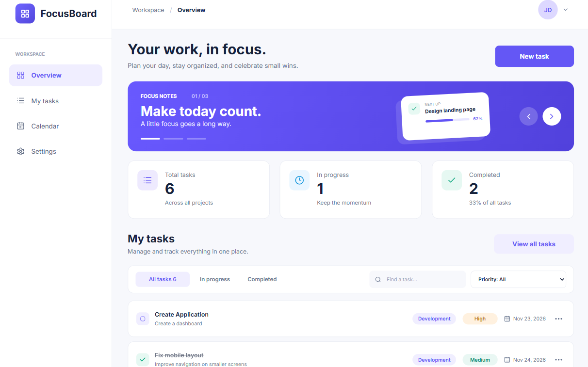
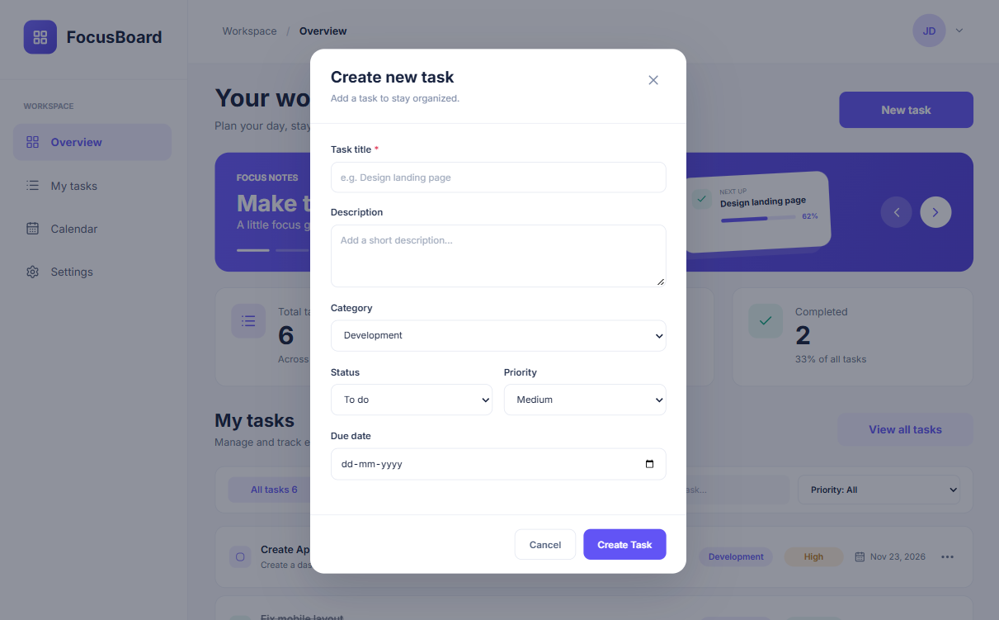
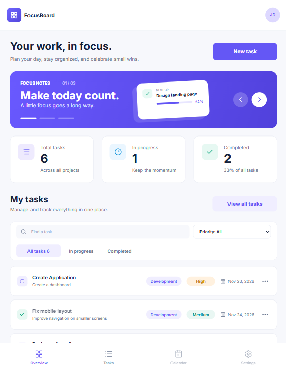
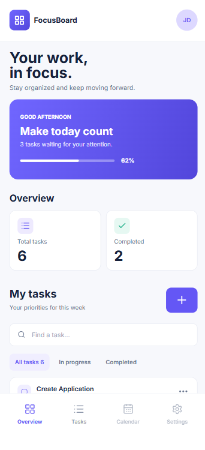
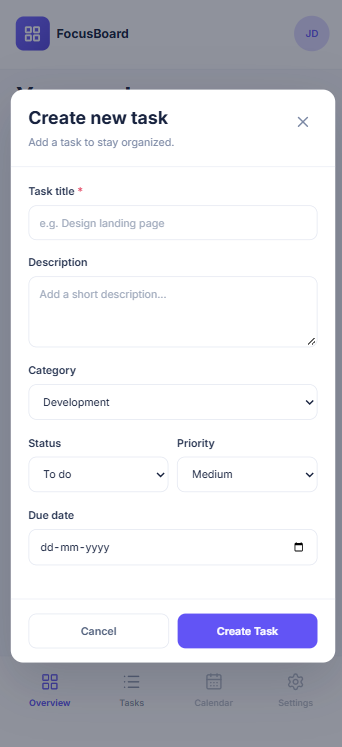

# FocusBoard - Task Management Dashboard

FocusBoard is a responsive task management dashboard built using React.js and Vite. I created this project as part of a frontend trainee assignment based on the provided Figma design.

The dashboard helps users organize their tasks, track their progress, and manage their daily work.

## Technologies Used

- React.js
- JavaScript
- HTML
- CSS
- Vite
- Lucide React (icons)
- Local Storage

## Features

- Add new tasks with a title, description, status, priority, category, and due date.
- Edit and delete existing tasks.
- Mark tasks as completed or move them back to To do.
- Search tasks by title or description.
- Filter tasks by status and priority.
- View total, in-progress, and completed task counts.
- View the task completion percentage.
- Navigate through three Focus Notes slides on desktop.
- Saves tasks in local storage so changes remain after refreshing the page.
- Responsive layout for desktop, tablet, and mobile screens.

## How to Run the Project

**1. Clone the repository**

```bash
git clone https://github.com/Sarah-Shaik/FocusBoard
```

**2. Open the project folder**

```bash
cd FocusBoard/focusboard
```

**3. Install dependencies**

```bash
npm install
```

**4. Start the development server**

```bash
npm run dev
```

Open the local URL displayed in the terminal to view the application.

## Implementation

I divided the dashboard into separate React components such as Header, Sidebar, FocusNotes, StatCard, TaskList, TaskCard, and TaskForm.

I used React hooks to manage the tasks, filters, search input, and form visibility.

The task list is updated when a user adds, edits, deletes, or completes a task. The dashboard statistics are calculated from the task data, so they also update automatically.

I used CSS media queries to make the layout responsive for different screen sizes.

## State Management

I used React's `useState` hook because the application is small and does not need an additional state management library.

The main task state is managed in `App.jsx` and passed to other components using props.

I also created a `useLocalStorage` custom hook to save and retrieve tasks from the browser's local storage. This helps keep the task changes even after refreshing the page.

The Focus Notes component uses its own state to manage the active slide.

## Screenshots

### Desktop





### Tablet



### Mobile





## Live Demo

[URL](https://focusboard-chi-one.vercel.app)

[GitHub Repository](https://github.com/Sarah-Shaik/FocusBoard)

## Limitations

- This is a frontend-only project without a backend or database.
- Tasks are stored in the browser's local storage and are not shared across devices.
- Calendar and Settings are currently placeholder navigation options.
- The mobile Focus Notes section follows the provided mobile Figma design and does not include carousel controls.

## AI Usage

Details about the AI tools used during development are included in the `AI_USAGE.md` file.